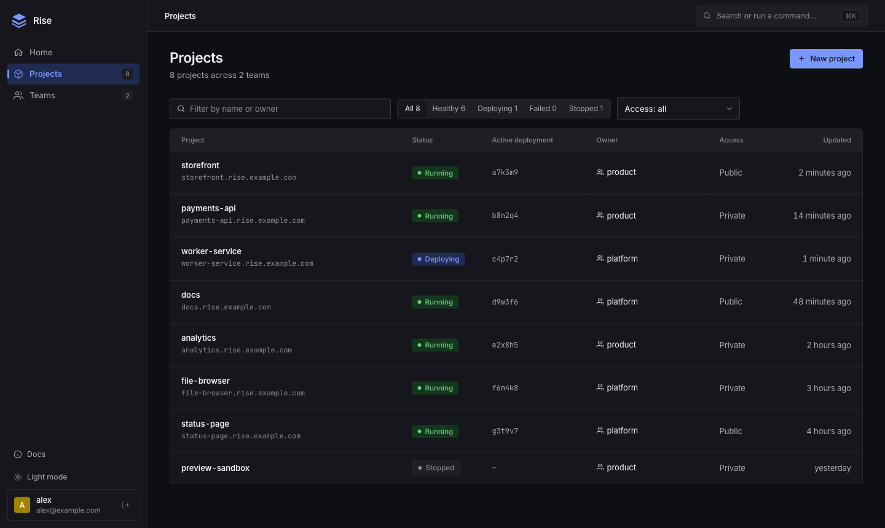

<p align="center">
  
</p>

<h1 align="center">Rise</h1>

<p align="center"><strong>Your apps. Your infrastructure. One deploy command.</strong></p>

<p align="center">
  A self-hosted application platform with a simple CLI and web dashboard.<br />
  Deploy to Docker, Kubernetes, or Amazon ECS with minimal configuration.
</p>

<p align="center">
  <a href="https://rise-deploy.github.io/rise/user/user-guide/getting-started/">Get started</a> ·
  <a href="https://rise-deploy.github.io/rise/user/">Documentation</a> ·
  <a href="https://rise-deploy.github.io/rise/operator/">Run Rise</a> ·
  <a href="https://github.com/rise-deploy/rise/releases">Releases</a>
</p>

> **Disclaimer:** This project makes heavy use of AI-generated code.



## From source to running app

- **Build your way** — Dockerfiles, Cloud Native Buildpacks, Railpack, or pre-built images.
- **Ship with your team** — projects, environments, preview deployments, and CI/CD workload identity.
- **Stay in control** — deployment status and logs in the dashboard, team access, and OAuth2/OIDC authentication for Rise and your apps.

## Get started

With [mise](https://mise.jdx.dev/) installed and a Rise instance available, run
this from your app's directory. Replace the URL with your instance:

```bash
mise use -g github:rise-deploy/rise
rise login --url https://rise.example.com
rise project create my-app
rise deploy
```

The [getting started guide](https://rise-deploy.github.io/rise/user/user-guide/getting-started/)
covers prerequisites, installation alternatives, and your first deployment.
Need an instance? Start with the
[Docker quick start](https://rise-deploy.github.io/rise/operator/docker/quick-start/).

## Explore the docs

| I want to… | Go to |
| --- | --- |
| Deploy and manage apps | [User docs](https://rise-deploy.github.io/rise/user/) |
| Choose a runtime and operate Rise | [Operator docs](https://rise-deploy.github.io/rise/operator/) |
| Run the code locally | [Local development](https://rise-deploy.github.io/rise/operator/development/) |
| Contribute or cut a release | [Contributing](CONTRIBUTING.md) · [Releasing](https://rise-deploy.github.io/rise/operator/releasing/) |

## License

The core platform, CLI, and Docker backend are **MIT OR Apache-2.0**.
The Kubernetes and ECS backends and Helm chart use **BSL 1.1**;
production use requires a commercial license, with exemptions for non-profits.
See [Licensing](LICENSING.md) for terms, exemptions, and the four-year conversion
to MIT OR Apache-2.0.
