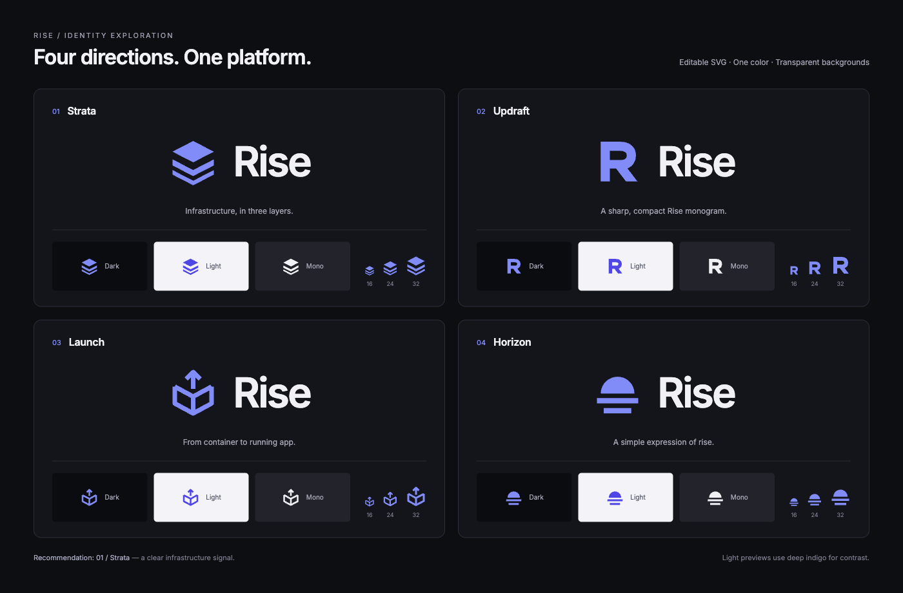

# Rise identity

**Strata is the Rise logo.** Three solid layers express the platform and its
deployed infrastructure. The canonical asset is
[`static/assets/logo.svg`](../../static/assets/logo.svg). The frontend uses it
as a mask in the selected accent color; the standalone SVG uses indigo.

## Logo concepts

Four editable SVG marks use the frontend's indigo accent. Each has a
transparent background and a single fill or stroke color (`#818cf8`).

| Concept | Idea | SVG |
| --- | --- | --- |
| **01 · Strata** | Three solid layers express a platform and deployed infrastructure. | [01-strata.svg](01-strata.svg) |
| **02 · Updraft** | An angular R gives Rise a compact, recognizable monogram. | [02-updraft.svg](02-updraft.svg) |
| **03 · Launch** | An upward arrow lifts out of an open container. | [03-launch.svg](03-launch.svg) |
| **04 · Horizon** | A rising sun above two bands gives the name a simple visual form. | [04-horizon.svg](04-horizon.svg) |

Strata's stacked silhouette communicates infrastructure and works in one color.
